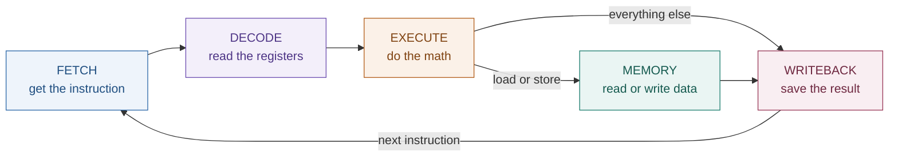
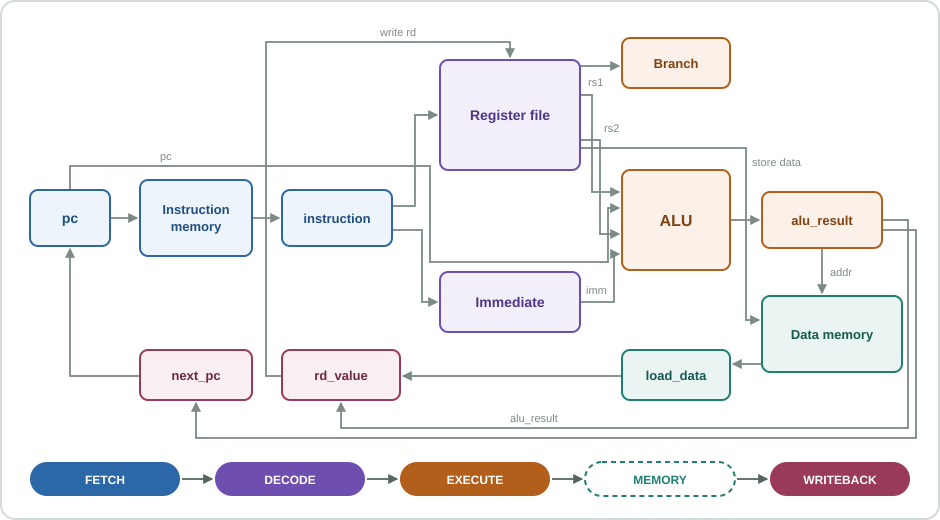

# Project 1: RISC-V CPU on an FPGA

We built a small 32-bit processor from scratch in SystemVerilog and ran it on the
iceBlinkPico FPGA board. It understands the RISC-V base instruction set (RV32I), so it can
run real programs written in RISC-V assembly. Our demo program uses it to fade the board's
LEDs through a rainbow.

ENGR 3410 Computer Architecture, Fall 2026.

## Demo

`programs/blink.s` running on the board. The RGB LED fades through the rainbow about every
3 seconds while the small user LED slowly brightens and dims.

Video coming soon.

## What it does

A processor repeats one job forever: get the next instruction, do it, move on. Each
instruction is one small step, like "add these two registers", "load a value from
memory", or "jump to a different part of the program".

This processor is **multicycle**, which means it works on one instruction at a time and
splits that instruction into a few clock cycles. It supports every RV32I instruction except
`ecall`, `ebreak`, and the CSR instructions. That covers math, logic, shifts, comparisons,
loads, stores, branches, and jumps.

## How it works

Every instruction goes through the same steps, one step per clock cycle:



1. **Fetch.** The program counter (`pc`) holds the address of the current instruction. The
   CPU reads that instruction out of instruction memory.
2. **Decode.** The CPU splits the instruction into its parts: what operation it is, which
   registers it uses, and any number built into it (the immediate). It reads the two input
   registers.
3. **Execute.** The ALU does the actual work. It might add two numbers, compare them, work
   out a memory address, or work out where a jump should go. For branches, the branch unit
   decides whether to jump.
4. **Memory.** Only loads and stores use this step. A load reads a value from memory and a
   store writes one.
5. **Writeback.** The result is saved into the destination register, and `pc` moves to the
   next instruction.

So most instructions take 4 clock cycles, and loads and stores take 5.

Here is the whole datapath. Each block is colored by the step that uses it:



**What `pc+4` means:** each instruction is 4 bytes long, so the next instruction is always
4 addresses later. Normally the CPU just moves to `pc+4`. Jumps and taken branches use an
address the ALU worked out instead. A jump like `jal` also saves `pc+4` in a register, so
the program knows where to come back to.

**Why the clock edges matter:** the CPU updates on the falling edge of the clock and memory
on the rising edge. That gives memory half a cycle to use an address and half a cycle to
send the answer back, so every memory access fits inside one step.

## Memory map

Everything the CPU reads or writes has an address. The provided `memory.sv` decides what
each address is:

| Address | What's there |
| --- | --- |
| `0x0000` – `0x0FFF` | Data memory (4 KB) |
| `0x1000` – `0x1FFF` | Instruction memory (4 KB). Programs start at `0x1000` |
| `0xFFFFFFF4` | Microsecond timer (read only) |
| `0xFFFFFFF8` | Millisecond timer (read only) |
| `0xFFFFFFFC` | LED brightness: user LED, red, green, blue (one byte each) |

To blink an LED, a program just stores a value to `0xFFFFFFFC`.

## Files

| File | What it is |
| --- | --- |
| `cpu.sv` | The processor: the five steps and how data moves between the blocks |
| `register_file.sv` | The 32 registers (`x0` is always 0) |
| `immediate.sv` | Pulls the number built into each instruction out of its bits |
| `alu.sv` | The math unit: add, subtract, and, or, xor, shifts, compares |
| `branch.sv` | Decides if a branch jumps (equal, not equal, less than, ...) |
| `top.sv` | Connects the CPU to memory and the board's LEDs |
| `top_tb.sv` | The testbench: runs test programs and checks the results |
| `memory.sv` | Memory, LEDs, and timers (provided by the course) |
| `iceBlinkPico.pcf` | Which FPGA pins the clock and LEDs are on |
| `split_memhfile.py` | Splits a program into the files memory loads (provided) |
| `programs/` | The RISC-V assembly programs and their machine code |
| `images/` | Figures for this README |

## Programs

- **`blink.s`**: the board demo. Every 2 ms it reads the millisecond timer, moves one step
  around the color wheel, and writes the new color to the LEDs.
- **`rv32i_test.s`**: the test program provided with the course.
- **`rv32i_coverage.s`**: our own test for everything the provided one skips, like every
  branch type taken and not taken, and every load and store size.

## Testing

`top_tb.sv` runs both test programs in the Icarus Verilog simulator, then checks 49
register values against the answers they should have. The checks are grouped by
instruction type:

```
programs/rv32i_test
U-type
PASS  lui x1, 0xFEDCC + addi x1, x1, 0xA98         fedcba98
PASS  auipc x10, 0x12345 at 0x1028                 12346028
I-type ALU
PASS  srli x2, x1, 4                               0fedcba9
PASS  srai x3, x1, 4                               ffedcba9
...
ALL TESTS PASSED
```

On the FPGA, the design runs at up to about 18 MHz, faster than the board's 12 MHz clock.

## Run it yourself

You need the [OSS CAD Suite](https://github.com/YosysHQ/oss-cad-suite-build) and, to change
the programs, the [xPack RISC-V GCC](https://github.com/xpack-dev-tools/riscv-none-elf-gcc-xpack).

| Command | What it does |
| --- | --- |
| `make test` | Runs the testbench and prints PASS or FAIL for each check |
| `make sim` | Runs the tests and opens the waveforms in GTKWave |
| `make asm p=blink` | Assembles `programs/blink.s` into machine code |
| `make build` | Builds the FPGA bitstream |
| `make prog` | Loads it onto a plugged-in iceBlinkPico |
