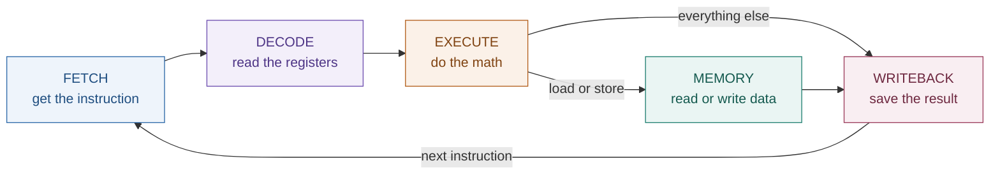

# Project 1

A 32-bit RISC-V processor written in SystemVerilog for the iceBlinkPico FPGA board. It runs
every RV32I instruction except `ecall`, `ebreak`, and the CSR instructions. The provided
`memory.sv` handles memory and the board's LEDs and timers.

## Demo

The blink program fades the RGB LED around the color wheel while the user LED fades in and
out.

Video coming soon.

## How it works

The processor is multicycle. It handles one instruction at a time and takes several clock
cycles to finish it, one per step:

Loads and stores take 5 clock cycles. Every other instruction skips the memory step and
takes 4.

Blocks in the datapath below are colored by the step that uses them.

## Memory map

| Address | What's there |
| --- | --- |
| `0x0000` – `0x0FFF` | Data memory (4 KB) |
| `0x1000` – `0x1FFF` | Instruction memory (4 KB). Programs start at `0x1000` |
| `0xFFFFFFF4` | Microsecond timer |
| `0xFFFFFFF8` | Millisecond timer |
| `0xFFFFFFFC` | LED brightness, one byte each for the user LED, red, green, and blue |

## Files

| File | What it is |
| --- | --- |
| `cpu.sv` | The processor: the steps above and the wiring between blocks |
| `register_file.sv` | The 32 registers. `x0` is always 0 |
| `immediate.sv` | Pulls the constant out of each instruction |
| `alu.sv` | Arithmetic, logic, shifts, and compares |
| `branch.sv` | Decides whether a branch is taken |
| `top.sv` | Connects the processor to memory and the LED pins |
| `top_tb.sv` | Testbench |
| `memory.sv` | Memory, LEDs, and timers (provided) |
| `iceBlinkPico.pcf` | Pin assignments for the board |
| `split_memhfile.py` | Splits a program into the files memory loads (provided) |
| `programs/` | Assembly programs and their machine code |

## Programs

| Program | What it does |
| --- | --- |
| `blink.s` | Uses the millisecond timer to step the LED color every 2 ms |
| `rv32i_test.s` | Test program provided with the course |
| `rv32i_coverage.s` | Our test for the instructions and cases the provided test does not cover |

## Testing

`top_tb.sv` runs `rv32i_test` and `rv32i_coverage` in Icarus Verilog for 5,000 clock cycles.
It then compares 49 register values with the values they should have and prints PASS or
FAIL for each one. Between them, the two programs use every instruction the processor
supports, including each branch both taken and not taken and each load and store size.
