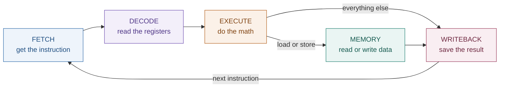

# Project 1

We designed a 32-bit RISC-V processor in SystemVerilog and ran it on the iceBlinkPico FPGA
board. It executes every RV32I instruction except `ecall`, `ebreak`, and the CSR
instructions. The provided `memory.sv` supplies the instruction and data memory along with
the board's LEDs and timers.

## Demo

The blink program fades the RGB LED around the color wheel while the user LED slowly
brightens and dims.

Video coming soon.

## How it works

Our processor is multicycle: it works on one instruction at a time and spends one clock
cycle on each step of that instruction.

This diagram is the state machine in `cpu.sv`. Each box is one state, and the arrows show
which state comes next. Only loads and stores go through the memory state, so they take 5
clock cycles. Every other instruction goes straight from execute to writeback and takes 4.
After writeback, the processor fetches the next instruction and starts over.

## Datapath

The datapath shows the hardware blocks in `cpu.sv` and how data moves between them. Each
block has the same color as the state that uses it in the diagram above, and the gray labels
on the wires are signal names from the code.

The blue blocks are used in fetch. `pc` holds the address of the current instruction and
starts at `0x1000`, where instruction memory begins. Instruction memory returns the 32-bit
word at that address, and the `instruction` register keeps it for the rest of the
instruction's steps.

The purple blocks are used in decode. The register file holds the 32 registers, with `x0`
always reading 0. It reads the two source registers named in the instruction, `rs1` and
`rs2`. The immediate block pulls out the constant encoded in the instruction. RISC-V places
those bits differently in each instruction format, so this block puts them back in order as
a 32-bit value.

The orange blocks are used in execute. The ALU does arithmetic, logic, shifts, and
comparisons. Its first input is `rs1`, or `pc` for `auipc`, `jal`, and branches. Its second
input is `rs2` for register-to-register instructions and the immediate for everything else.
That lets one adder compute ordinary results, load and store addresses, and jump targets.
`alu_result` saves the ALU's output for the later steps. At the same time, the branch block
compares `rs1` and `rs2` to decide whether a branch is taken.

The teal blocks are used in the memory state, which only loads and stores reach. Data memory
uses `alu_result` as the address. A store writes `rs2` there, and a load reads the value into
`load_data`.

The red blocks are used in writeback. `rd_value` chooses what to write into the destination
register: the ALU result, the loaded value, the immediate for `lui`, or the return address
for `jal` and `jalr`. `next_pc` chooses where to go next. That is normally the following
instruction at `pc + 4`, or the ALU's target for jumps and taken branches. Both are written
at the end of writeback.

## Memory map

`memory.sv` divides the 32-bit address space like this:

| Address | What's there |
| --- | --- |
| `0x0000` – `0x0FFF` | Data memory (4 KB) |
| `0x1000` – `0x1FFF` | Instruction memory (4 KB) |
| `0xFFFFFFF4` | Microsecond timer |
| `0xFFFFFFF8` | Millisecond timer |
| `0xFFFFFFFC` | LED brightness, one byte each for the user LED, red, green, and blue |

The timers and the LED register sit at the top of the address space. A program can reach
them with a negative offset from `x0`. For example, `sw a0, -4(x0)` sets all four LEDs at
once, and `lw t0, -8(x0)` reads the millisecond timer.

## Files

The processor itself is in `cpu.sv`. It contains the state machine, the registers that hold
values between states (`pc`, `instruction`, `alu_result`, and `load_data`), and the
multiplexers that choose each block's inputs. It uses four submodules that match blocks in
the datapath: `register_file.sv`, `immediate.sv`, `alu.sv`, and `branch.sv`.

`top.sv` connects the processor to `memory.sv` and to the board's LED pins, and
`iceBlinkPico.pcf` assigns those pins. `memory.sv` and `split_memhfile.py` came with the
assignment, and we did not change them.

`top_tb.sv` is the testbench, described under Testing. The `Makefile` assembles programs,
runs the tests, and builds and loads the design onto the board.

## Programs

Each program in `programs/` is kept as RISC-V assembly (`.s`) along with its machine code.
`make asm p=NAME` assembles a program and splits the machine code into four files, one for
each byte of a word, because that is the format `memory.sv` loads.

`blink.s` is the board demo. It waits until the millisecond timer has moved forward 2 ms,
then takes one step around the color wheel. The wheel has 1536 steps split into six
segments of 256, such as red to yellow and yellow to green, so one full cycle takes about
3 seconds. The user LED ramps up and back down over 512 steps. The program packs all four
brightness values into one word and stores it to the LED register.

`rv32i_test.s` is the test program provided with the assignment. We wrote
`rv32i_coverage.s` to test what it leaves out. That includes the remaining ALU
instructions, every branch type both taken and not taken, loads and stores of every size in
data memory, `fence`, writes to `x0`, and a `jalr` to an odd address, which has to clear the
lowest bit.

## Testing

`top_tb.sv` runs both test programs side by side in Icarus Verilog for 5,000 clock cycles,
which is enough for both to finish. It then reads the register file directly and makes 49
checks, comparing registers and the final `pc` with the values they should hold. Each check
prints PASS or FAIL, and the checks are grouped by instruction class. `make test` runs the testbench and ends with
`ALL TESTS PASSED` when every check passes.
